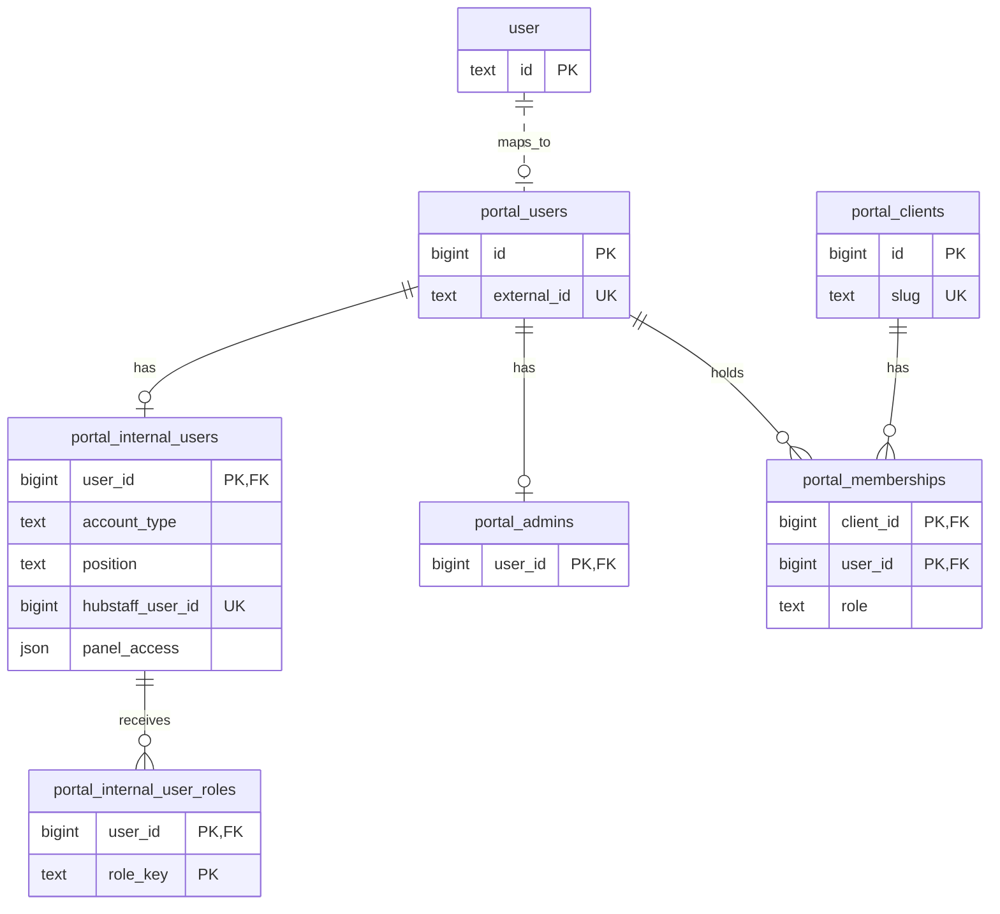
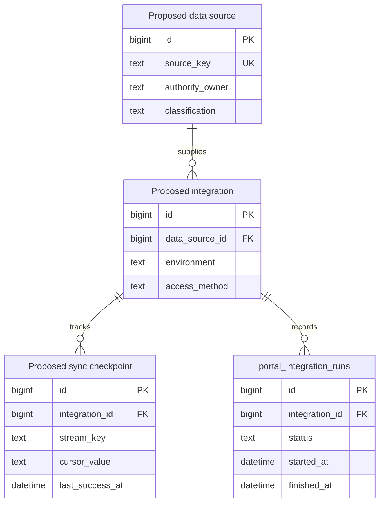

# Phase 0 Portal Entity Relationship Model

| Field | Value |
| --- | --- |
| Status | Draft for technical and data-owner review |
| Scope | Current identity/access schema and proposed read-only integration model |
| Planning source | [AOC Portal Integration Scope - Master Matrix](https://docs.google.com/spreadsheets/d/15sky-E2X0anax-GdUg9q-NBXWU3W6w44HTr0i5q_4Ro/edit) |

The existing database supports portal login, internal roles, and a limited integration-run audit. The proposed entities below define how Phase 1 source records can be joined and traced without making the portal the authority for Hubstaff, HubSpot, Help Scout, or Drive data. A proposed entity is **not** an applied migration or an approved field grant.

## Implemented identity and access relationships

`AUTH_USER` is Better Auth's `"user"` table. `portal_users.external_id` is a logical mapping to its ID, not a database foreign key. Internal roles are rows in `portal_internal_user_roles`; the permission policy is currently defined in code rather than a permission table. `portal_internal_access_audit` and `portal_integration_runs` already exist, but their actor references are nullable and the latter identifies its source by text rather than an integration foreign key. The current internal-user mapping is one Hubstaff member ID per account; it is not an organization roster. The Team directory reads the configured AOC Hubstaff team live and uses this mapping only to add portal-account labels and positions.

## Proposed integration control relationships

`DATA_SOURCE`, `INTEGRATION`, and `SYNC_CHECKPOINT` are conceptual names for future standard-PostgreSQL tables. `INTEGRATION_RUN` corresponds to the existing `portal_integration_runs` table, but its proposed `integration_id` foreign key is **not present** today. Approving this model does not authorize a schema migration; each change must be committed, reviewed, and tested separately. A source may have distinct staging and production integrations, credentials, and checkpoints. Credential values remain in server-only deployment secrets or the existing approved encrypted store, not in this registry.

## Proposed read-only domain relationships

| Domain entity | Proposed parent or join | Stable source identity | Relationship or access decision still needed |
| --- | --- | --- | --- |
| Team and project assignments | Internal user to team or project through an approved assignment source | Source system plus assignment ID | Name the authoritative assignment source before `managed_team` or `assigned_projects` grants go live. |
| Project and task | Task to project; task assignees may be many-to-many | Hubstaff project/task/member IDs | Do not assume names or the current portal roster uniquely identify source members. |
| Time entry | Source member, project, and task when provided | Hubstaff time-entry ID | Unmapped organization members must not be silently discarded or given portal accounts. |
| Approved absence and expected shift | Source member and time interval | Hubstaff request/schedule IDs | HR must approve status, partial-day, timezone, completeness, and field rules. A missing schedule is not an off-shift fact. |
| CRM company, contact, and deal | HubSpot associations, with optional approved client mapping | HubSpot object IDs | Do not join a portal client by display name. Confirm objects and custom properties with Sales. |
| Support conversation | Help Scout mailbox, assignee, and optional approved client mapping | Help Scout conversation/thread IDs | Confirm inbox scope and workflow mapping before mirroring. |
| Drive source document or row | Approved Drive file and, where structured, row key | Drive file ID and stable row key | Classify each source as structured sync, permission-aware index, or link only. |

Every normalized record needs its source system and record ID, source link when available, source modification time when available, last successful sync time, and data owner. Use a uniqueness rule equivalent to `(source, source_record_id)` within each entity, but approve the exact keys after inspecting each provider API. Provider records may exist without a portal account or client mapping; authorization must never infer a broader scope from a missing relationship.

## Review decisions

| Decision | Approver | Status |
| --- | --- | --- |
| Identity/access cardinalities and account boundaries | Technical owner and Security/IT | Pending |
| Authoritative team/project assignment relationships | Project Management and Hubstaff owner | Pending |
| Leave and shift relationships, fields, and timestamps | HR/Admin and Hubstaff owner | Pending |
| HubSpot, Help Scout, and Drive source keys and client mappings | Respective system and data owners | Pending |
| Integration registry, checkpoint, run-audit, and retention model | Technical owner and Security/IT | Pending |

See [Phase 0 closeout](PHASE_0_CLOSEOUT.md) for owners, access paths, staging evidence, and approval status. Database changes remain governed by [PostgreSQL portability](DATABASE_PORTABILITY.md).
